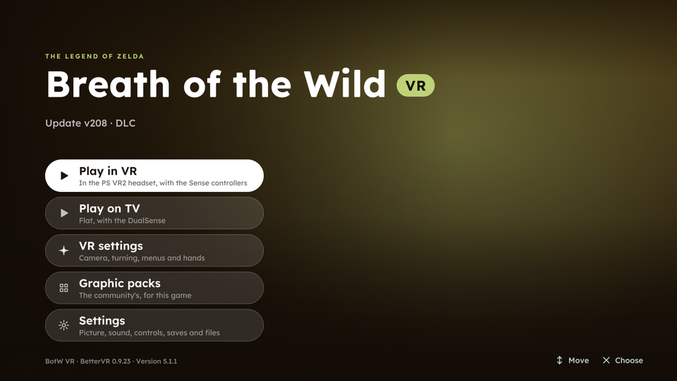
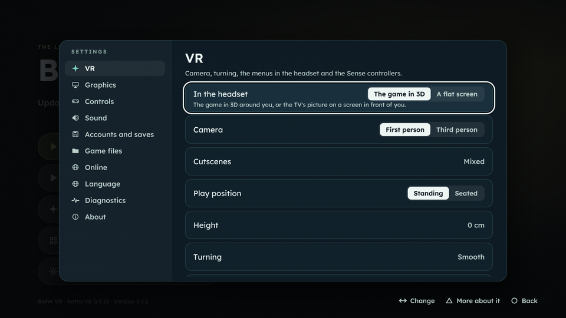

# Breath of the Wild in VR on PS5: what you need and where it goes

Everything needed to play BotW-BetterVR on a jailbroken PS5 with PlayStation VR2, with this fork's
app, **Breath of the Wild VR** (title ID `PPSA98720`, from the `m5-botw-vr` pre-release on). It is
an app of its own: it sits next to PS5-ECAM, if you have it, and shares nothing with it. **Nobody has run these builds on a console yet** (see `STATUS.md`): this page says how
they are meant to be set up, not what has been seen to work.

Nothing from Nintendo or Sony comes with the app. You bring the game, dumped from your own Wii U
disc or console.

## 1. What you need

| | What | Notes |
| --- | --- | --- |
| Console | A PS5 that runs homebrew, with a HEN, elfldr and ShadowMount Plus | The same setup PS5-ECAM needs ([HEN setup](../HEN-SETUP.md)). |
| HEN list | **`PPSA98720`** added to your HEN's app jailbreak list | New for this app: PS5-ECAM's `PPSA99360` there doesn't cover it. etaHEN: its app jailbreak list; OnionHEN: the end of `exact_title_ids` in its config, with no comma after it. Without it Cemu gets no JIT and runs far too slowly for VR. |
| Headset | PS VR2, plugged in and set up in the PS5's settings | Its first-time setup (play area, eye distance) done once from the PS5's own menus. |
| Controllers | Both PS VR2 Sense controllers, paired and charged | From `m4-sense` on. A DualSense works too, as the Wii U GamePad. |
| Game | **The Legend of Zelda: Breath of the Wild, Wii U version** | Any region: USA, Europe or Japan. Not the Switch version. |
| Update | **Update v208** (game version 1.5.0), the last one | BetterVR's code patches are written for v208 only. With an older update, or none, it won't work. |
| DLC | Optional | The Expansion Pass works if you have it, but isn't needed. |
| Keys | **Only** for encrypted WUD/WUX disc images | WUA files and unpacked games need no keys. See section 3. |

No Wii U system files are needed (`otp.bin`, `seeprom.bin` and the like are only for Nintendo
Network, which BotW doesn't use). No PS5 keys, firmware files or PS5 SDK either.

## 2. The game's format

Use one of these. They are listed from simplest to most work.

| Format | What it looks like | Keys? | Update and DLC |
| --- | --- | --- | --- |
| **WUA** (recommended) | One `.wua` file | No | Can be inside the same WUA: one file with game, v208 and DLC. |
| **Unpacked game** | A folder with `code/`, `content/`, `meta/` (decrypted) | No | Installed separately (section 4). |
| **Unpacked game in an archive** | That folder in a `.zip`, `.7z`, `.rar` or `.tar.*`, one game per archive | No | Installed separately; not read from archives. |
| **WUD / WUX** | A disc image, `.wud` or `.wux` | **Yes:** the disc key | Installed separately. |
| **Packed title** | A folder with `title.tmd`, `title.tik` and `.app` files | No, but `title.tik` must be there | Cemu reads it as it is. |

What a dump from your own console gives you depends on the tool. **dumpling** (on a Wii U with
Aroma/Tiramisu) gives unpacked folders for the game, its update and its DLC. Cemu on a PC (version
2.0 or newer) can then turn the three into one WUA: **Tools > Title Manager**, right-click the game,
**Convert to compressed Wii U archive (.wua)**. That WUA is the easiest thing to bring over.

BotW's title IDs, if a tool asks or to check that a dump is complete:

| | USA | Europe | Japan |
| --- | --- | --- | --- |
| Game | `00050000101C9400` | `00050000101C9500` | `00050000101C9300` |
| Update (v208) | `0005000E101C9400` | `0005000E101C9500` | `0005000E101C9300` |
| DLC | `0005000C101C9400` | `0005000C101C9500` | `0005000C101C9300` |

## 3. Where the files go

Everything of this app's is in **`/data/botwvr`**:

```text
/data/botwvr/
├── cemu/
│   ├── games/                      the game: a .wua, a .wud/.wux, or an unpacked folder
│   │   └── The Legend of Zelda Breath of the Wild.wua
│   ├── updates/                    an unpacked update v208 (if it isn't inside your WUA)
│   │   └── BotW Update v208/
│   │       ├── code/  content/  meta/
│   ├── dlc/                        an unpacked DLC (optional)
│   │   └── BotW DLC/
│   │       ├── code/  content/  meta/
│   ├── keys.txt                    only for an encrypted WUD/WUX
│   └── mlc01/                      Cemu's storage: installed update and DLC, and your saves
└── launcher/
    ├── bettervr.json               the VR switch (section 7)
    └── logs/boot.log
```

The app makes these folders on its first start; you can also make them yourself. Folder and file
names inside `games/`, `updates/` and `dlc/` don't matter: the app reads the title ID inside each
one. The games folder can also be another folder or a USB drive: **Settings > Game files**.

With the app installed on a USB drive instead, the same two folders are in `BotWVR/` at the top of
that drive.

**keys.txt** (only for WUD/WUX). One line per disc. The line is the disc key as 32 hexadecimal
characters, optionally followed by a comment:

```text
00112233445566778899aabbccddeeff # Breath of the Wild (EUR)
```

The disc key is the one your disc-dumping tool saved next to the image, often as `game.key` (16
bytes). Turn it into hex with `xxd -p game.key` on a PC.

**Coming from PS5-ECAM?** Your BotW there is in `/data/cemu` (or `/data/ps5cemu` on an older
install). To take it over, copy:

- the game file into `/data/botwvr/cemu/games/`;
- `mlc01/usr/title/0005000e/101c9x00` (the installed update), `mlc01/usr/title/0005000c/101c9x00`
  (DLC) and `mlc01/usr/save/00050000/101c9x00` (your saves) into the same places under
  `/data/botwvr/cemu/mlc01/`. `x` is 4 for USA, 5 for Europe, 3 for Japan.

Copying, not moving, leaves PS5-ECAM's copy as it was.

### Getting the files onto the PS5

Any of these:

- **FTP**, from a PC, with your HEN's FTP server.
- **A USB drive** (exFAT): put the game in a folder on it and choose that folder in **Settings > Game
  files**, or copy it across with a file manager on the PS5.
- **The app's upload page**, from a phone or PC browser: turn on **Settings > System > Remote touch
  screen**, then open `http://<the PS5's address>:8080/files`, choose the Wii U games
  folder and send the file. It takes WUA, WUD/WUX and archives, not loose folders. `bettervr.json` and `keys.txt` go over
  FTP.

## 4. Install the update (and DLC)

Skip this if your WUA already has update v208 in it.

1. Start the app.
2. **Settings > Game files > Updates, DLC and mods.** It lists what it found in `cemu/updates`,
   `cemu/dlc`, your games folder, USB drives and `/data`.
3. Choose the update with Cross (or Square for everything new). It is copied into Cemu's storage
   (`/data/botwvr/cemu/mlc01`). This takes a few minutes for BotW's 3 GB update.
4. In the Library, Breath of the Wild's page should now show update **v208**.

## 5. Install this build

1. From the pre-release (`m5-botw-vr` or newer), download `BotW-VR-v5.1.1.zip` and `SHA256SUMS`,
   and check them on a PC:

   ```bash
   sha256sum -c SHA256SUMS --ignore-missing
   ```

2. Copy the zip's `PPSA98720` folder to `/data/homebrew/PPSA98720`. PS5-ECAM, in
   `/data/homebrew/PPSA99360`, stays as it is.
3. Let ShadowMount Plus put it on the home screen, as for any homebrew. It shows as **Breath of the
   Wild VR**.
4. It doesn't update itself: newer builds are this repository's pre-releases, copied over the same
   way.

**The tile and background.** The app comes with a plain picture of its own (nothing of Nintendo's
can be in it). Once it has found your Breath of the Wild, it makes its tile from the game's box art
(GameTDB's, or the game's own icon) and its home screen background from the game's boot screen,
and writes them into its own folder. Whether the home screen shows them at once, after a restart,
or only once ShadowMount Plus puts the app on the home screen again is not known yet (Test
request 5).

## 6. First start, flat

Do this once without VR, so a problem with the game itself doesn't look like a VR problem.

1. With no `bettervr.json` (or `{"vr": false}`), start the app and start BotW.
   Check that it gets in-game. The first start builds shaders and stutters; that's normal.
2. Back in the Library: **Options** on the game > **Graphic packs** >
   **The Legend of Zelda: Breath of the Wild**. Turn **Mods > FPS++** on, with its FPS limit at 120
   or higher. **BetterVR crashes without FPS++.**
3. Quit to the Library.

## 7. VR

**From `m9` on** the app is a launcher for this one game:



- **Play in VR** or **Play on TV** on the home screen. The app turns BetterVR's graphic pack (and
  FPS++ for VR) on or off as the game starts: no file to edit, no restart.
- **VR settings** (also the first page of **Settings**): BetterVR's options: camera (first or third
  person), cutscenes, standing or seated, height, turning (snap or smooth), walking direction,
  swings, left-handed, the menus in the headset (follow your view, distance, size), black bars in
  cutscenes; and the app's own: the game in 3D or a flat screen in the headset, and the Sense
  controllers' hand and aim angles. Each change is saved at once and used at the next Play in VR.
- **Graphic packs:** Breath of the Wild's community packs, nothing else.
- The Sense controllers move through the menus too (stick to move, Cross to choose, Circle to go
  back).



Turn on both Sense controllers and put on the headset before Play in VR.

**`m8`:** the app opens on Breath of the Wild's page in the emulator's launcher, with Play in VR and
Play on TV; the other VR options are only in `bettervr.json` (below).

**Before `m8`** (`m5` to `m7`):

1. Put `{"vr": true}` in `/data/botwvr/launcher/bettervr.json`.
2. **Close the app and start it again.** BetterVR's graphic pack is put in place when the app starts.
3. In BotW's graphic packs, **Better VR** should now be listed and on, next to FPS++.
4. Turn on both Sense controllers, put on the headset, and start the game.
5. To play flat again, set `{"vr": false}` and restart the app.

Optional settings in `/data/botwvr/launcher/bettervr.json`, with any build:

| Setting | What it does |
| --- | --- |
| `"bettervr": false` | No BetterVR: the game as a flat screen in the headset (M2), to compare. |
| `"gripPitch": 30`, `"aimPitch": 30` | Tilt the controllers' poses, in degrees, if Link's hands point the wrong way. |

BetterVR's own menu, in the game: long-press the right stick (R3).

## 8. If something goes wrong

- **The game isn't in the Library:** **Settings > Game files > Look for games now.** An encrypted
  WUD/WUX without its key says *"Its disc key is missing from …/keys.txt"* when started.
- **Better VR isn't in the graphic packs** (before `m8`): the app wasn't restarted after
  `bettervr.json` changed, or the file isn't valid JSON (check the quotes).
- **It crashes at the title screen with BetterVR:** FPS++ off, or an update other than v208.
- **Logs:** Settings > Diagnostics > **Copy logs to USB**, or `/data/botwvr/launcher/logs/boot.log` over FTP.
  VR's lines start with `[vr]`, `[vr-xr]` and `[bettervr]`. `STATUS.md`'s Test requests say which
  ones to send.
